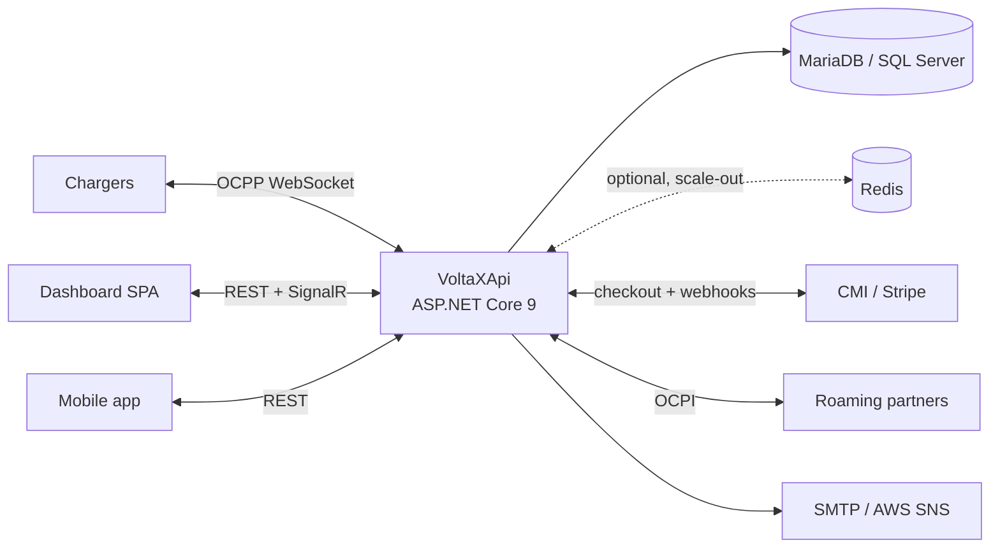

# EVEON

[](https://github.com/GeekChanaa/eveon/actions/workflows/ci.yml)
<!-- The badge shows a status once GitHub Actions is enabled for the repository. -->

EVEON (code name VoltaX) is an electric vehicle charging platform: a charge point management system (CSMS)
that runs chargers over OCPP 2.0.1 and 1.6J, bills charging sessions from a prepaid wallet topped up online,
roams with partners over OCPI 2.2.1, and serves an operator dashboard, customer and partner portals and a
mobile app.

## Architecture



Components, request, OCPP and billing flows, the auth model and scale-out: [docs/architecture.md](docs/architecture.md).

## Repository layout

| Path | Content |
| --- | --- |
| `VoltaXApi/` | API: OCPP CSMS (`OCPP/`), REST controllers, SignalR hubs (`Hubs/`), OCPI (`Ocpi/`), smart charging, EF Core data layer and migrations (`Data/`, `Migrations/`), `Dockerfile`, `deploy.sh`, `deploy/` (env templates, Caddy, scale-out compose) |
| `VoltaXDashboardSpa/` | Angular 16 dashboard: operator back office, customer portal, partner portal; `deploy.sh` |
| `volta_x_mobile/` | Flutter mobile app (UI prototype) |
| `tests/VoltaX.Tests/` | xUnit tests: API endpoints and authorization, OCPP scenarios, billing, payments, portals |
| `tests/VoltaX.*Checks/` | Console checks run by hand against a development database |
| `tools/e2e/` | Simulator end-to-end and load runner (EVEON_SIM against the API on a throwaway database) |
| `VoltaXScrappers/` | Charger catalogue scraper and its images (reference data) |
| `docs/` | Documentation (below), OCPP message samples |
| `docker-compose.dev.yml` | Local MariaDB (and optional SQL Server, Redis) |
| `.github/` | CI, release workflow, Dependabot |

## Local setup

Prerequisites: .NET SDK 9, Node.js 20, Docker; Flutter 3.35 for the mobile app.

### Database

```bash
docker compose -f docker-compose.dev.yml up -d          # MariaDB 11.8 on 127.0.0.1:3306, root password "eveon-dev"
# SQL Server instead: docker compose -f docker-compose.dev.yml --profile sqlserver up -d (sa / "Eveon-dev-1")
```

### API

Secrets live in .NET user-secrets, outside the repository ([docs/configuration.md](docs/configuration.md)):

```bash
cd VoltaXApi
dotnet user-secrets set "AppSettings:Token" "$(openssl rand -base64 64)"
dotnet user-secrets set "Database:Provider" "MySql"
dotnet user-secrets set "Database:ServerVersion" "11.8.0"
dotnet user-secrets set "ConnectionStrings:DefaultConnection" "Server=127.0.0.1;Port=3306;Database=eveon;User=root;Password=eveon-dev;"
# SQL Server: leave Database:Provider unset and use
#   "Server=127.0.0.1,1433;Database=eveon;User Id=sa;Password=Eveon-dev-1;TrustServerCertificate=true"

dotnet run -- --migrate            # create / update the schema (docs/database.md)
dotnet run --launch-profile VoltaXApi   # http://localhost:8000, Swagger at /swagger
```

Each start runs the first setup check: built-in roles, defaults and, unless `FirstSetup:TestUsers:Enabled` is
false, test accounts whose new passwords are mailed to `FirstSetup:TestUsers:CredentialsRecipient`. For a
real first administrator use `--create-admin` ([docs/configuration.md](docs/configuration.md)).

### Dashboard

```bash
cd VoltaXDashboardSpa
npm ci
npm start                          # http://localhost:4200, talks to http://localhost:8000
```

### Mobile app

```bash
cd volta_x_mobile
flutter pub get
flutter run
```

## Configuration

Settings are environment variables in containers (`:` becomes `__`) and user-secrets in development. Names
only; meanings, defaults and templates are in [docs/configuration.md](docs/configuration.md)
and `VoltaXApi/deploy/api.env.example`.

| Area | Variables |
| --- | --- |
| Required | `AppSettings__Token`, `ConnectionStrings__DefaultConnection`; in production also `AllowedHosts`, `Cors__AllowedOrigins__0..n` |
| Database | `Database__Provider`, `Database__ServerVersion`, `Database__MigrateOnStartup`, `Database__FailOnPendingMigrations` |
| Hosting | `ASPNETCORE_ENVIRONMENT`, `PORT`, `ASPNETCORE_URLS`, `ReverseProxy__KnownProxies__0..n`, `ReverseProxy__TrustAllProxies`, `Security__HttpsRedirection`, `HEALTHCHECK_HOST` |
| Tokens | `AppSettings__Issuer`, `AppSettings__Audience`, `AuthTokens__AccessTokenMinutes`, `AuthTokens__RefreshTokenDays` |
| Sign-in and messages | `Authentication__Google__ClientId`, `Authentication__Google__ClientSecret`, `MailSettings__Host`, `MailSettings__Port`, `MailSettings__Mail`, `MailSettings__Username`, `MailSettings__Password`, `AwsSns__AccessKey`, `AwsSns__SecretKey`, `AwsSns__Region`, `AwsSns__TopicArn`, `SpaLink`, `AuthLink` |
| Payments | `Payments__Provider`, `Payments__PublicApiUrl`, `Payments__SpaUrl`, `Payments__Cmi__*`, `Payments__Stripe__*`, `Payments__Sandbox__Secret` ([docs/payments.md](docs/payments.md)) |
| OCPP and PKI | `Ocpp__AllowInsecureProfile1`, `Ocpp__Tls__*`, `Pki__*` |
| OCPI | `Ocpi__Enabled`, `Ocpi__CountryCode`, `Ocpi__PartyId`, `Ocpi__BaseUrl` |
| Scale-out | `ScaleOut__Redis__ConnectionString`, `ScaleOut__InstanceId` ([docs/scale-out.md](docs/scale-out.md)) |
| Rate limits | `RateLimiting__AuthStrictPerMinute`, `RateLimiting__PublicPerMinute`, `RateLimiting__GlobalPerMinute` |
| First setup | `FirstSetup__*`, `Bootstrap__AdminEmail`, `Bootstrap__AdminPassword` |

## Tests

```bash
dotnet test tests/VoltaX.Tests/VoltaX.Tests.csproj -c Release      # API (in-memory SQLite, no database needed)
cd VoltaXDashboardSpa && npm run test:ci                           # dashboard, headless Chrome
cd volta_x_mobile && flutter test                                  # mobile app
tools/e2e/run-e2e.sh                                               # simulator end-to-end (needs EVEON_SIM)
```

What each layer covers, the end-to-end and load runs: [docs/testing.md](docs/testing.md).

CI ([.github/workflows/ci.yml](.github/workflows/ci.yml)) also applies every migration to empty MariaDB and
SQL Server databases, scans new commits for secrets and audits dependencies.

## Deployment

The API ships as one Docker image (an EC2 test host with `VoltaXApi/deploy-ec2.sh`, or any Docker host
with `VoltaXApi/deploy.sh`), migrations run at deploy time with `--migrate`, and the dashboard deploys to
Hostinger. See [docs/deployment.md](docs/deployment.md).

## Documentation

| Document | Content |
| --- | --- |
| [architecture.md](docs/architecture.md) | Components and flows |
| [configuration.md](docs/configuration.md) | Settings, secrets, hosting, OCPP security profiles and charger PKI |
| [database.md](docs/database.md) | Providers, migrations, applying them, verification |
| [deployment.md](docs/deployment.md) | Image, EC2 host, Docker host, storage, dashboard, CI |
| [testing.md](docs/testing.md) | Test layers, simulator end-to-end and load runs |
| [ocpp.md](docs/ocpp.md) | OCPP 2.0.1 / 1.6 support and message coverage; [samples](docs/ocpp-samples/README.md) |
| [billing.md](docs/billing.md) | Prices, formula, VAT, invoices |
| [payments.md](docs/payments.md) | Wallet top-ups, providers, webhooks |
| [refresh-tokens.md](docs/refresh-tokens.md) | Sessions and refresh tokens |
| [dashboard-authorization.md](docs/dashboard-authorization.md) | Roles, permissions, enforcement |
| [scale-out.md](docs/scale-out.md) | Several API instances with Redis |
| [security-runbook.md](docs/security-runbook.md) | Manual security steps (secret rotation) |
