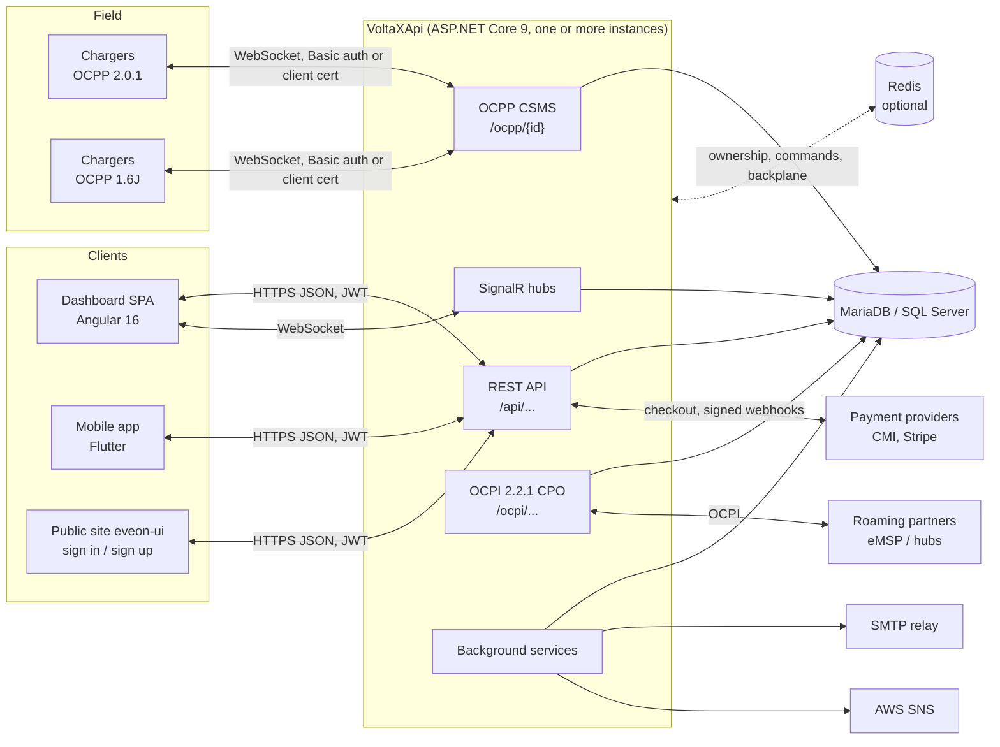
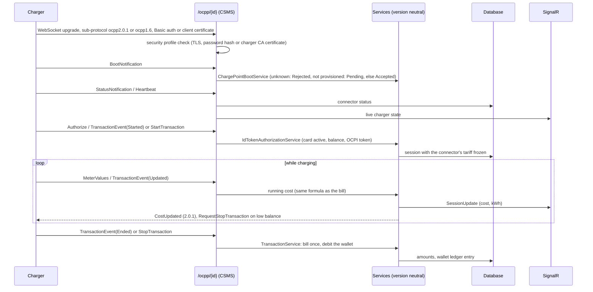

# Architecture

EVEON (code name VoltaX) is a charge point management system: it operates EV chargers over OCPP, sells
charging to drivers from a prepaid wallet, and gives operators, partners (station owners) and customers a
dashboard. This page is the map; the linked documents hold the details.

## Components

| Component | Where | What it does |
| --- | --- | --- |
| OCPP CSMS | `VoltaXApi/OCPP`, `OCPP/Ocpp16` | WebSocket endpoint `/ocpp/{chargePointId}`, sub-protocols `ocpp2.0.1` and `ocpp1.6`, inbound handlers, outbound commands, security profiles 1 to 3, charger PKI. [ocpp.md](ocpp.md) |
| REST API | `VoltaXApi/Controllers` | Operator back office (`/api/...`), customer portal (`/api/my`), partner portal (`/api/partner-portal`), payments (`/api/payments`), sign in (`/api/auth`, `/api/auth/phone`), mobile endpoints |
| SignalR hubs | `VoltaXApi/Hubs` | `/chargerHub` (live charger and connector state), `/chargingSessionHub` (live session cost and energy), `/notificationHub` |
| OCPI | `VoltaXApi/Ocpi` | CPO role, version 2.2.1: versions, credentials, locations, tariffs, sessions, CDRs, tokens, commands; outbound pushes through an outbox (`OcpiPushWorker`) |
| Smart charging | `VoltaXApi/SmartCharging` | Charging profiles, station load limits and allocation |
| Background services | `Services`, `OCPP.Services`, `Ocpi/Services` | Stale transaction sweeper, reservation expiry, card expiry warnings, PKI renewal monitor, OCPI push, data retention and GDPR jobs, refresh token cleanup |
| Database | EF Core, `Data/VoltaXApiDbContext.cs` | MariaDB in production, SQL Server supported, one migration set. [database.md](database.md) |
| Scale-out | `VoltaXApi/ScaleOut` | Optional Redis: charger ownership, command forwarding, SignalR backplane, shared caches. [scale-out.md](scale-out.md) |
| Dashboard | `VoltaXDashboardSpa` | Operator dashboard (`/dashboard`), customer portal (`/my-dashboard`), partner portal; French, English, Arabic (RTL) |
| Mobile app | `volta_x_mobile` | Flutter UI prototype (sign up, phone verification); same auth contract as the dashboard |

## Request flow (REST)

1. `UseForwardedHeaders` restores the client scheme, address and host from trusted proxies (Caddy, Railway's
   edge); host filtering rejects hosts outside `AllowedHosts`; HTTPS redirection and security headers apply.
2. Authentication reads the JWT bearer token; the authorization stage answers 401 to anonymous callers on
   every endpoint not marked public, before the body is read.
3. The global rate limiter partitions by user (or address): strict limits on sign-in endpoints.
4. The access filter loads the caller, role and permissions **from the database on every request**: JWT claims
   never grant access. Endpoint permissions map each action to view / create / edit / delete; customer and
   partner endpoints are scoped to the caller's own data. [dashboard-authorization.md](dashboard-authorization.md)
5. Controllers call services and repositories over EF Core; changes are audited by a SaveChanges interceptor.
6. Request logging writes one line per request with a correlation id (Serilog, console in containers).

## OCPP flow

Each inbound CALL runs in its own DI scope. Commands to a charger go through `IOcppCommandSender`, which
picks the charger's protocol version and, with Redis, forwards the call to the instance that holds the
socket. Transactions a charger never ends are closed by the stale transaction sweeper. Message samples:
[ocpp-samples](ocpp-samples/README.md).

## Billing flow

- A connector carries its prices (per kWh, per minute, flat fee, per idle minute), all VAT included.
  When a session starts they are copied onto the session: a later price change never alters it.
- One formula (`Services/CostCalculator.cs`) gives the live cost, the low-balance stop, the final debit, the
  invoice and the statistics. Rounding is per component, to the cent.
- The wallet is the customer's card balance. Every change is a wallet ledger entry with a unique reference
  (`session:{id}:charge`, `order:{id}:topup`...), and balances use optimistic concurrency, so a retried
  event never debits or credits twice.
- Online top-ups: the API creates a pending order, the customer pays on the provider's page (CMI 3-D Secure
  or Stripe Checkout; a sandbox outside production), and only the provider's signed server-to-server
  notification credits the wallet. Card numbers never reach the API.

Details: [billing.md](billing.md), [payments.md](payments.md).

## Authentication and authorization

| Who | How |
| --- | --- |
| Operators, customers, partners | Email and password, Google sign-in, or a phone number with an SMS code (AWS SNS). The API issues a short-lived JWT access token (60 minutes by default) and a rotating refresh token whose SHA-256 hash is stored; reusing a revoked refresh token revokes the account's sessions. A second factor for accounts that enable it. [refresh-tokens.md](refresh-tokens.md) |
| Permissions | Roles (Admin, Customer, Partner and custom roles) with per-feature permissions, checked against the database on each request and on each hub call |
| Chargers | OCPP security profiles: 1 = HTTP Basic (plain `ws://` only when allowed), 2 = TLS + Basic, 3 = TLS client certificate issued by the EVEON charger CA. [configuration.md](configuration.md) |
| Roaming partners | OCPI credentials (token exchange), one party per partner |
| Payment providers | Signed webhooks (CMI hash, Stripe signature), recorded once per event id |

Secrets come from environment variables or user-secrets only; the API refuses to start without the
required ones. [configuration.md](configuration.md), [security-runbook.md](security-runbook.md).

## Deployment and scale-out

- One Docker image (`VoltaXApi/Dockerfile`) runs everywhere: Railway today, or a Docker host behind Caddy
  (`VoltaXApi/deploy.sh`). Migrations run at deploy time with `--migrate`. [deployment.md](deployment.md)
- Without Redis the API is a single instance and keeps charger sockets, SignalR groups and caches in
  memory. With `ScaleOut__Redis__ConnectionString`, several instances share charger ownership (a charger
  may connect to any instance), forward commands to the owner, fan SignalR events out through the Redis
  backplane, and share caches. Load balancing needs no affinity for chargers and REST, cookie affinity for
  SignalR. Background services still run on every instance. [scale-out.md](scale-out.md)
- Health: `/health/live` (process up) for liveness and the container health check, `/health/ready`
  (database, and Redis when configured) for readiness.
